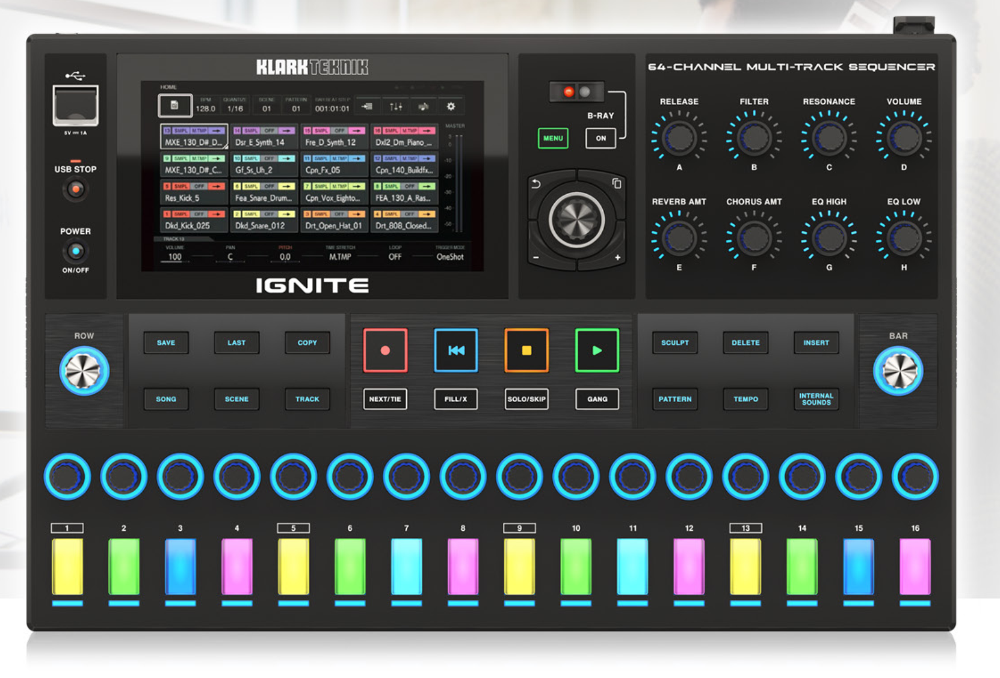
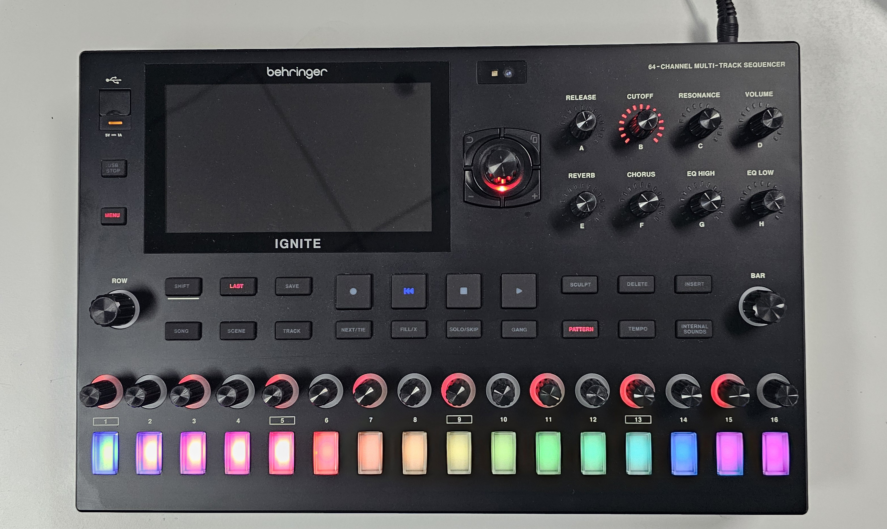
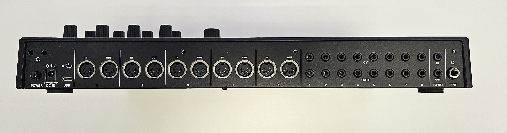
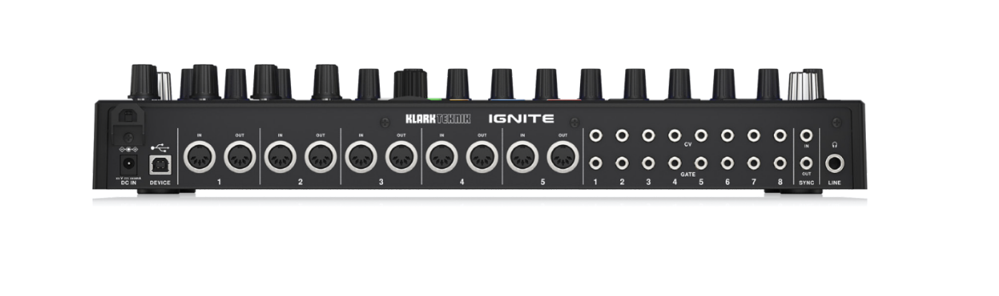
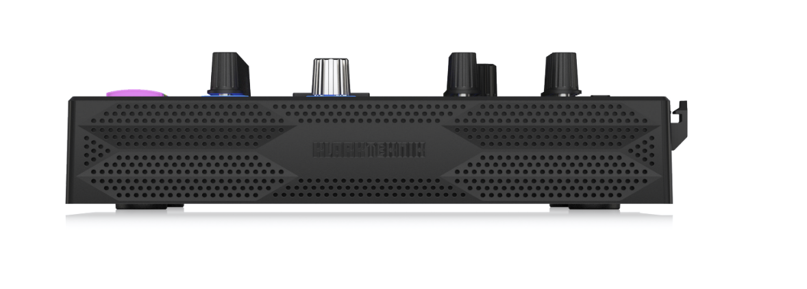

  

# Behringer IGNITE (BE 0716-AAF)

> There is a Creator in every human being. Our mission is to empower those who have not and cannot.

Source code for the Behringer IGNITE 64-channel multi-track sequencer.

  

## Release status

This repository contains the IGNITE application, its audio engine and hardware protocol, and the
Buildroot tree for the Linux image. Material that could not be redistributed was removed, so some
parts need your own replacements before they build (see the README in each folder). There is no
official firmware release here yet.

## Front panel

- Touchscreen
- 16 RGB step pads, each with its own encoder
- 8 assignable knobs (A–H) and a jog wheel
- ROW and BAR encoders
- Transport, song/scene/track/pattern, and edit buttons
- USB-A port (5 V, 1 A) with a USB STOP button

## Connections

  

| Rear panel |
|---|
| Power switch, 12 V DC input (2000 mA) |
| USB-C |
| 5 × MIDI IN / OUT (5-pin DIN) |
| 8 × CV, 8 × Gate |
| Sync in and out |
| Line / headphone output |

## Repository

| Folder | Contents | License |
|---|---|---|
| [`Source/Application/`](Source/Application) | IGNITE application (UI, model and hardware integration, built on JUCE) | AGPL-3.0-or-later |
| [`AudIO/`](AudIO) | Audio engine library | AGPL-3.0-or-later |
| [`ComProtocol/`](ComProtocol) | Hardware communication protocol | AGPL-3.0-or-later |
| [`Linux/`](Linux) | Buildroot Linux image for the i.MX8M Mini SOM | GPL-2.0 (Buildroot) |

## Licensing

Original software in this repository is licensed under **AGPL-3.0-or-later**; see [LICENSE](LICENSE).
The Buildroot tree in `Linux/` is GPL-2.0 (see `Linux/buildroot/COPYING`), and the packages it builds keep
their own licenses.

Third-party components retain their original licenses and notices. Each folder's README lists the
bundled third-party code and its license. The LICENSE does not relicense third-party code, images or
trademarks.

## Contribute and get help

You do not need organization membership or a company account to participate. Use your own GitHub
account to open an issue or send a pull request. Sign off commits with `git commit -s`.

- [Contribution guide](https://github.com/MusicTribeOpenSource/.github/blob/main/CONTRIBUTING.md)
- [Code of conduct](https://github.com/MusicTribeOpenSource/.github/blob/main/CODE_OF_CONDUCT.md)
- [Community governance](https://github.com/MusicTribeOpenSource/.github/blob/main/GOVERNANCE.md)
- [Discord community](https://discord.gg/gS6qtuShvw)

## Security

Do not disclose vulnerabilities, personal information or credentials in public issues.
Use [private vulnerability reporting](https://github.com/MusicTribeOpenSource/0716-AAF/security/advisories/new).
See [SECURITY.md](SECURITY.md) for scope and response expectations.

## Maintainers

Reviews are routed to the organization's **Owners** team. Default-branch protection,
code-owner review and the organization's sign-off workflow apply here.

Product renders (early design)

These renders show an earlier design and do not match the shipping hardware in every detail.

  
  

## Names and logos

Behringer and Klark Teknik are brands of MUSIC Tribe. The Behringer and Klark Teknik names and logos,
and the IGNITE name and logo, are not granted under the software license. The product photos and
renders in `docs/images/` are not covered by the software license either. See the organization's
[trademark policy](https://github.com/MusicTribeOpenSource/.github/blob/main/TRADEMARKS.md).

Copyright (c) MUSIC Tribe.
